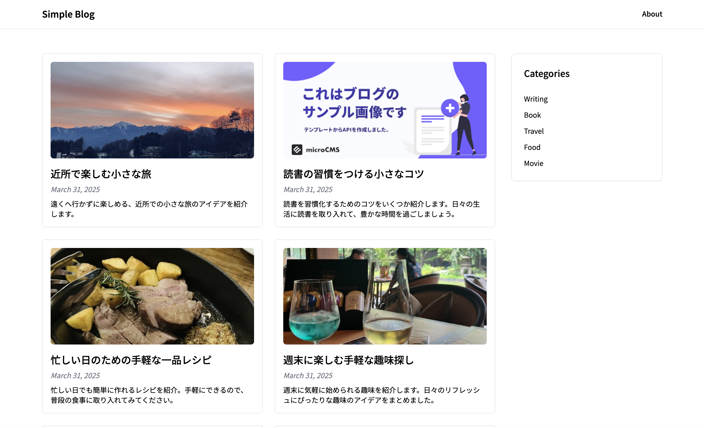
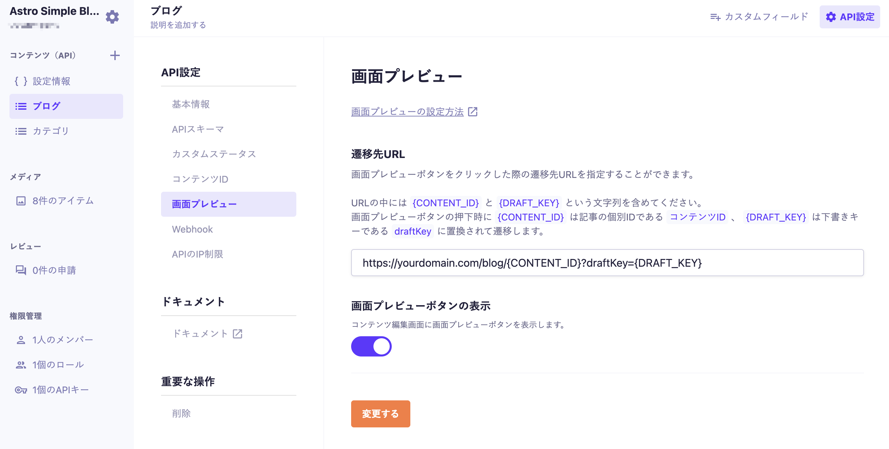

# Astroを使用したシンプルなブログ



Astroを使用したシンプルなブログのテンプレートです。

## 動作環境

Node.js 24 以上

## 環境変数の設定

ルート直下に`.env`ファイルを作成し、下記の情報を入力してください。

```
PUBLIC_MICROCMS_API_KEY=xxxxxxxxxx
PUBLIC_MICROCMS_SERVICE_DOMAIN=xxxxxxxxxx
SITE_URL=https://your-domain.example
```

画面プレビューURLは `https://your-domain.example/preview/?contentId={CONTENT_ID}&draftKey={DRAFT_KEY}` に設定してください。

`PUBLIC_MICROCMS_API_KEY`  
microCMS 管理画面の「サービス設定 > API キー」から確認することができます。
このAPIキーはブラウザへ公開されるため、読み取り専用（GETのみ）の権限にしてください。

`PUBLIC_MICROCMS_SERVICE_DOMAIN`

microCMS 管理画面の URL（https://xxxxxxxx.microcms.io）の xxxxxxxx の部分です。

`SITE_URL`

本番サイトのURLです。OGP・RSS・sitemap・robots.txtの絶対URLに使用します。開発時は省略でき、省略時は`http://localhost:4321`を使用します。

お問い合わせフォームの送信先は、microCMSの設定APIにある`SSGFormUrl`から取得します。未設定の場合は既定のSSG Form URLを使用します。

## 開発の仕方

1. パッケージのインストール

```bash
npm install
```

2. 開発環境の起動

microCMSの画面プレビューURLは `http://localhost:4321/preview/?contentId={CONTENT_ID}&draftKey={DRAFT_KEY}` に設定すると、ローカルでも下書きを表示できます。

```bash
npm run dev
```

3. 開発環境へのアクセス  
   [http://localhost:4321](http://localhost:4321)にアクセス

## 画面プレビューの設定

下書き状態のコンテンツをプレビューするために、microCMS管理画面にて画面プレビューの設定が必要です。

ブログAPIの「API設定 > 画面プレビュー」に下記のように設定してください。  
※`yourdomain.com`は環境に合わせて置き換えてください。（localhost指定でも動作します）



設定後はコンテンツ編集画面にて画面プレビューボタンが利用可能になります。

## デプロイ

サイトは静的にビルドされ、`/preview/` ページがブラウザからmicroCMSへ下書きデータを取得します。このため、静的HTMLを配信できるホスティングで利用できます。

## Node.js のバージョンについて

このテンプレートは **Node.js 24 以上**を前提としています。

Node.js では定期的にセキュリティアップデートが提供されています。  
安全にご利用いただくため、Node.js を利用する際は
**利用中のメジャーバージョン（例: 24.x）の最新パッチバージョンを使用することを推奨します。**

最新のセキュリティ情報については、以下をご参照ください。
https://nodejs.org/ja/blog/vulnerability/
